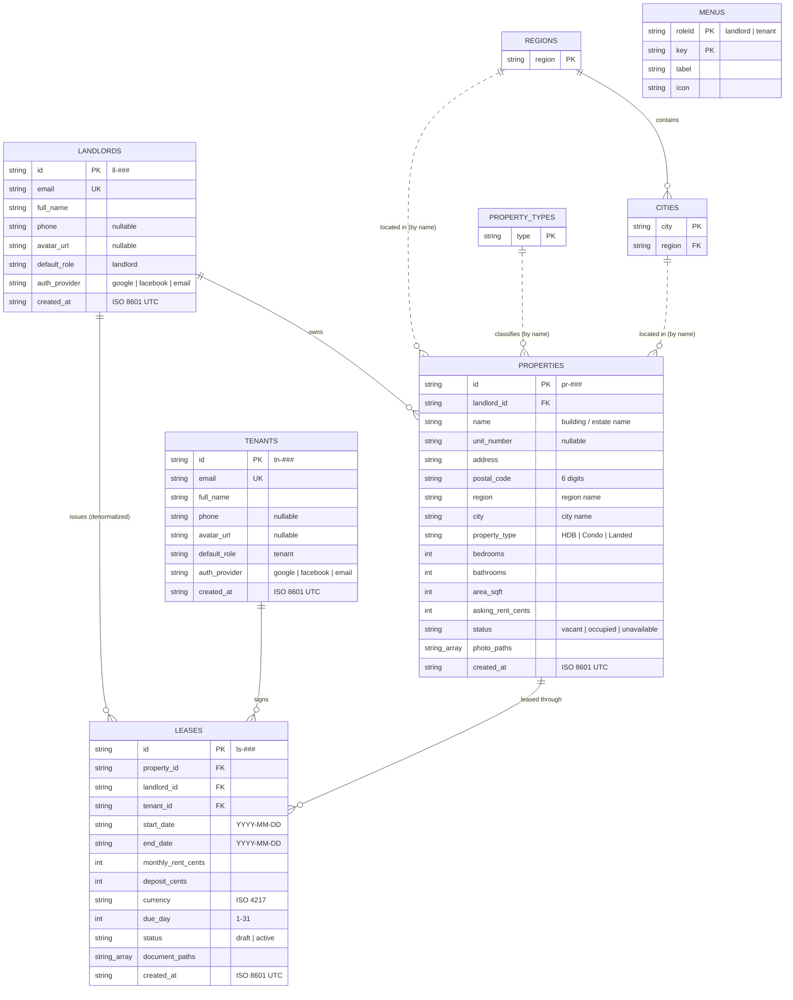

# CasaHero Data Schema

The tables, columns, types and relationships behind CasaHero, as of 2026-11-19.

> **2026-11-19: flattened.** `properties` and `units` were merged into one `properties` table. Each row is one rentable unit, and leases point at `property_id`. See [`RestructureData.md`](RestructureData.md).

> **Source of truth.** CasaHero has no database yet. The Express server (`casahero-server/server.js`) only stubs `signup`, `login` and `logout`. Everything below comes from the MSW mock data layer:
>
> - `src/mocks/db.js`: the hand-written records and lookup lists
> - `src/mocks/seedListings.js`: generates most properties
> - `src/mocks/handlers.js`: how the endpoints read and join the data
>
> Each "table" here is an exported array in `db.js`. The **Type** column gives the JavaScript type used today. **SQL type** is a suggested type for a real database (PostgreSQL). See [`api-contracts.md`](../../api-contracts.md) for the endpoints that serve this data.

## Contents

1. [Entity–relationship diagram](#entityrelationship-diagram)
2. [Core tables](#core-tables): `landlords`, `tenants`, `properties`, `leases`
3. [Lookup tables](#lookup-tables): `regions`, `cities`, `property_types`, `menus`
4. [Relationships](#relationships)
5. [Conventions](#conventions)
6. [Data volumes](#data-volumes)
7. [Known issues and gaps](#known-issues-and-gaps)
8. [Suggested DDL](#suggested-ddl-postgresql)

## Entity–relationship diagram

Solid lines are id-based foreign keys. Dotted lines are relationships matched by **value** (for example `properties.city` holds a city name, not an id).



`menus` isn't joined to any table. It is keyed by role, the same value as `default_role` on landlords and tenants.

## Core tables

### `landlords`

People who own properties and issue leases. Defined in `db.js`. Served by `GET /landlords` and returned as the `user` on login.

| Column | Type | SQL type | Key | Null | Notes |
|---|---|---|---|---|---|
| `id` | string | `text` | PK | No | Prefix `ll-`, e.g. `ll-001`. Generated users get `ll-<timestamp>`. |
| `email` | string | `citext` | Unique | No | Login matches it case-insensitively. |
| `full_name` | string | `text` | | No | |
| `phone` | string | `text` | | Yes | E.164 with spaces, e.g. `+65 9123 4567`. |
| `avatar_url` | string | `text` | | Yes | Always `null` in the mocks. |
| `default_role` | string | `text` | | No | Always `landlord`. Drives routing (`/landlord`) and the menu set. |
| `auth_provider` | string | `text` | | No | `google`, `facebook` or `email`. |
| `created_at` | string | `timestamptz` | | No | ISO 8601, UTC. |

### `tenants`

People who rent properties. Defined in `db.js`, with the same shape as `landlords`. No endpoint lists them.

| Column | Type | SQL type | Key | Null | Notes |
|---|---|---|---|---|---|
| `id` | string | `text` | PK | No | Prefix `tn-`, e.g. `tn-001`. |
| `email` | string | `citext` | Unique | No | |
| `full_name` | string | `text` | | No | |
| `phone` | string | `text` | | Yes | |
| `avatar_url` | string | `text` | | Yes | |
| `default_role` | string | `text` | | No | Always `tenant`. |
| `auth_provider` | string | `text` | | No | `google`, `facebook` or `email`. |
| `created_at` | string | `timestamptz` | | No | |

**Signed-up users.** `POST /signup` stores new users in an in-memory `registeredUsers` array in `handlers.js`, which resets on page reload. They have the landlord/tenant shape plus a **`password`** column (plain text, mock only). `withoutPassword()` strips it before a user is returned.

### `properties`

One rentable unit that a landlord owns: an HDB flat, a condo unit, a landed house or a room in one. The 6 hand-written records (`pr-001` to `pr-006`) are in `db.js`. `seedListings()` generates the rest. Served by `POST /listings` as a flat array.

Units in the same building or estate are separate rows that repeat the building's `name`, `address`, `postal_code`, `region` and `city`.

| Column | Type | SQL type | Key | Null | Notes |
|---|---|---|---|---|---|
| `id` | string | `text` | PK | No | Prefix `pr-`, zero-padded to at least 3 digits (`pr-001` … `pr-3006`). |
| `landlord_id` | string | `text` | FK → `landlords.id` | No | The seed alternates `ll-001` and `ll-002` by building. |
| `name` | string | `text` | | No | Building/estate name, e.g. `Tampines Central Flat`, `Parc @ Bishan`. Repeats across units in one building. |
| `unit_number` | string | `text` | | Yes | `#08-112` for HDB/Condo, `No. 3`, `Main house` or `Annex room` for landed. `null` for a whole house with no unit number. Unique within a building. |
| `address` | string | `text` | | No | HDB: `Blk <n> <street>`. Others: `<house no> <street>`. |
| `postal_code` | string | `char(6)` | | No | String to keep leading zeros (`018987`). Starts with the area's postal sector. Identifies the building. |
| `region` | string | `text` | → `regions.region` (by value) | No | Duplicates the region of `city`. |
| `city` | string | `text` | → `cities.city` (by value) | No | |
| `property_type` | string | `text` | → `property_types.type` (by value) | No | `HDB`, `Condo` or `Landed`. The search `type` filter matches this column. |
| `bedrooms` | number | `smallint` | | No | Integer. HDB 2–4, Condo 1–4, Landed 4–6 in the seed. |
| `bathrooms` | number | `smallint` | | No | Integer, at least 1. |
| `area_sqft` | number | `integer` | | No | |
| `asking_rent_cents` | number | `integer` | | No | Minor units: `320000` = S$3,200.00. Currency is implicitly SGD. |
| `status` | string | `text` | | No | `vacant`, `occupied` or `unavailable`. |
| `photo_paths` | string[] | `text[]` | | No | Storage paths, e.g. `properties/pr-001/living.jpg`. Empty array when there are none. |
| `created_at` | string | `timestamptz` | | No | |

### `leases`

A tenancy agreement between a landlord and a tenant for one property. Defined in `db.js`. Served by `GET /leases`.

| Column | Type | SQL type | Key | Null | Notes |
|---|---|---|---|---|---|
| `id` | string | `text` | PK | No | Prefix `ls-`. |
| `property_id` | string | `text` | FK → `properties.id` | No | |
| `landlord_id` | string | `text` | FK → `landlords.id` | No | Denormalized: also reachable through `property → landlord`. |
| `tenant_id` | string | `text` | FK → `tenants.id` | No | |
| `start_date` | string | `date` | | No | `YYYY-MM-DD`. |
| `end_date` | string | `date` | | No | `YYYY-MM-DD`, after `start_date`. |
| `monthly_rent_cents` | number | `integer` | | No | The agreed rent. Can differ from the property's `asking_rent_cents`. |
| `deposit_cents` | number | `integer` | | No | 1× or 2× monthly rent in the mocks. |
| `currency` | string | `char(3)` | | No | ISO 4217, `SGD` today. |
| `due_day` | number | `smallint` | | No | Day of the month rent is due (1 or 5 in the mocks). |
| `status` | string | `text` | | No | `draft` or `active` in the mocks. |
| `document_paths` | string[] | `text[]` | | No | e.g. `leases/ls-001/tenancy-agreement.pdf`. |
| `created_at` | string | `timestamptz` | | No | |

## Lookup tables

### `regions`

Options for the Region dropdown (`POST /regions`).

| Column | Type | SQL type | Key | Notes |
|---|---|---|---|---|
| `region` | string | `text` | PK | 9 values: East, West, North, South, Central, North-West, North-East, South-East, South-West. |

### `cities`

Options for the City dropdown, filtered by region (`GET /cities?region=`).

| Column | Type | SQL type | Key | Notes |
|---|---|---|---|---|
| `region` | string | `text` | FK → `regions.region` | |
| `city` | string | `text` | PK | 20 cities. Names are unique, so the name works as the key. |

Cities exist only in North, North-East, East, West and Central. The other four regions have none, so their dropdown is empty.

### `property_types`

Options for the type pills on the search bar (`GET /types`). Exported from `db.js` as `propertyTypes`.

| Column | Type | SQL type | Key | Notes |
|---|---|---|---|---|
| `type` | string | `text` | PK | `HDB`, `Condo`, `Landed`. |

### `menus`

Sidebar entries per role (`GET /menus`).

| Column | Type | SQL type | Key | Notes |
|---|---|---|---|---|
| `roleId` | string | `text` | PK (with `key`) | `tenant` or `landlord`. Matches `default_role`. |
| `key` | string | `text` | PK (with `roleId`) | e.g. `home`, `Search`, `leases`. Repeats across roles. |
| `label` | string | `text` | | Display text. |
| `icon` | string | `text` | | Icon name for `SidebarIcon`. |

Tenants get Home, Search, Rent, Maintenance, Messages and Documents. Landlords get home, Search, Leases, Rent, Maintenance Requests and Messages.

## Relationships

| From | To | Cardinality | Joined on | Enforced by |
|---|---|---|---|---|
| `landlords` | `properties` | 1 → 0..N | `properties.landlord_id = landlords.id` | Convention only |
| `properties` | `leases` | 1 → 0..N | `leases.property_id = properties.id` | Convention only |
| `tenants` | `leases` | 1 → 0..N | `leases.tenant_id = tenants.id` | Convention only |
| `landlords` | `leases` | 1 → 0..N | `leases.landlord_id = landlords.id` | Convention only (denormalized) |
| `regions` | `cities` | 1 → 0..N | `cities.region = regions.region` | The `/cities` handler filters on it |
| `cities` | `properties` | 1 → 0..N | `properties.city = cities.city` | By value |
| `regions` | `properties` | 1 → 0..N | `properties.region = regions.region` | By value |
| `property_types` | `properties` | 1 → 0..N | `properties.property_type = property_types.type` | By value |
| role | `menus` | 1 → N | `menus.roleId = <user>.default_role` | The `/menus` handler filters on it |

In plain terms: a **landlord** owns **properties**, and each property is one rentable unit. A **lease** ties one property to one **tenant** for a date range at an agreed rent. Properties are placed by **region** and **city** and classified by **property type**.

The lease data is consistent with property status today: `pr-001` and `pr-003` are `occupied` with an `active` lease, and `pr-005` is `vacant` with only a `draft` lease.

## Conventions

- **IDs** are strings with a type prefix and a zero-padded number: `ll-`, `tn-`, `pr-`, `ls-`. Users created at runtime use `Date.now()` instead of a padded number.
- **Money** is an integer in minor units (cents), with a `_cents` suffix. Only `leases` stores a `currency`. Properties are implicitly SGD.
- **Timestamps** are ISO 8601 strings in UTC (`created_at`). **Dates** without a time are `YYYY-MM-DD` (`start_date`, `end_date`).
- **Files** are stored as relative storage paths in `*_paths` arrays, never as URLs.
- **Column names** are `snake_case`, except `menus.roleId`.
- **Seeded data is deterministic.** `seedListings.js` uses a fixed-seed PRNG (mulberry32, seed `20261025`), so ids and values are the same on every reload.

## Data volumes

| Table | Rows | How |
|---|---|---|
| `landlords` | 2 | Hand-written |
| `tenants` | 3 | Hand-written |
| `properties` | 3,006 | 6 hand-written + 10 buildings per city × 15 units × 20 cities |
| `leases` | 3 | Hand-written |
| `regions` | 9 | Hand-written |
| `cities` | 20 | Hand-written |
| `property_types` | 3 | Hand-written |
| `menus` | 12 | 6 per role |

## Known issues and gaps

1. **Landlords and tenants are separate tables with the same shape.** One person can't be both, and the role is baked into the id prefix. A single `users` table with a role column (or a `user_roles` join table) would fix that.
2. **Location and type are stored as names, not keys.** `properties.city`, `region` and `property_type` are free text. Renaming a city would orphan its properties.
3. **`properties.region` duplicates `cities.region`.** Nothing stops a property from having a region that doesn't match its city.
4. **`leases.landlord_id` duplicates `property → landlord_id`.** It can drift if a property changes owner.
5. **Building details repeat on every unit.** `name`, `address`, `postal_code`, `region` and `city` are copied onto each row in a building, so renaming a condo means updating every row. Group by `postal_code` to find a building's units. If building-level data (facilities, management contacts) is needed later, a small `buildings` lookup can come back as an optional FK.
6. **Nothing ties `properties.status` to leases.** A property could be `vacant` while it has an `active` lease. A rule is also needed for at most one active lease per property at a time.
7. **Missing audit columns.** No table has `updated_at`.
8. **Status values aren't constrained.** `properties.status` and `leases.status` are open strings. Lease statuses such as `ended` or `terminated` don't exist yet.
9. **Passwords are stored in plain text** in the signup mock. A real backend must hash them and keep them out of every response.

Resolved by the 2026-11-19 flattening: the unused `type` column (it overlapped `property_type`) was dropped, and the `bed`/`bath` filters now compare with `>=` as documented.

## Suggested DDL (PostgreSQL)

A starting point that follows the current shape and fixes issues 1–3 and 6–8. It is a proposal, not something the code uses yet.

```sql
CREATE EXTENSION IF NOT EXISTS citext;

CREATE TABLE users (
  id             text PRIMARY KEY,
  email          citext NOT NULL UNIQUE,
  full_name      text NOT NULL,
  phone          text,
  avatar_url     text,
  default_role   text NOT NULL CHECK (default_role IN ('landlord', 'tenant')),
  auth_provider  text NOT NULL CHECK (auth_provider IN ('google', 'facebook', 'email')),
  password_hash  text,                      -- only for auth_provider = 'email'
  created_at     timestamptz NOT NULL DEFAULT now(),
  updated_at     timestamptz NOT NULL DEFAULT now()
);

CREATE TABLE regions (
  region  text PRIMARY KEY
);

CREATE TABLE cities (
  city    text PRIMARY KEY,
  region  text NOT NULL REFERENCES regions (region) ON UPDATE CASCADE
);

CREATE TABLE property_types (
  type  text PRIMARY KEY
);

CREATE TABLE properties (
  id                 text PRIMARY KEY,
  landlord_id        text NOT NULL REFERENCES users (id),
  name               text NOT NULL,
  unit_number        text,                  -- null for a whole house
  address            text NOT NULL,
  postal_code        char(6) NOT NULL CHECK (postal_code ~ '^[0-9]{6}$'),
  city               text NOT NULL REFERENCES cities (city) ON UPDATE CASCADE,  -- region comes from cities
  property_type      text NOT NULL REFERENCES property_types (type) ON UPDATE CASCADE,
  bedrooms           smallint NOT NULL CHECK (bedrooms >= 0),
  bathrooms          smallint NOT NULL CHECK (bathrooms >= 0),
  area_sqft          integer NOT NULL CHECK (area_sqft > 0),
  asking_rent_cents  integer NOT NULL CHECK (asking_rent_cents >= 0),
  status             text NOT NULL CHECK (status IN ('vacant', 'occupied', 'unavailable')),
  photo_paths        text[] NOT NULL DEFAULT '{}',
  created_at         timestamptz NOT NULL DEFAULT now(),
  updated_at         timestamptz NOT NULL DEFAULT now()
);

-- one row per unit in a building; NULLS NOT DISTINCT stops two whole-house rows at one postal code
CREATE UNIQUE INDEX properties_building_unit_idx ON properties (postal_code, unit_number) NULLS NOT DISTINCT;

CREATE TABLE leases (
  id                  text PRIMARY KEY,
  property_id         text NOT NULL REFERENCES properties (id),
  landlord_id         text NOT NULL REFERENCES users (id),
  tenant_id           text NOT NULL REFERENCES users (id),
  start_date          date NOT NULL,
  end_date            date NOT NULL CHECK (end_date > start_date),
  monthly_rent_cents  integer NOT NULL CHECK (monthly_rent_cents >= 0),
  deposit_cents       integer NOT NULL CHECK (deposit_cents >= 0),
  currency            char(3) NOT NULL DEFAULT 'SGD',
  due_day             smallint NOT NULL CHECK (due_day BETWEEN 1 AND 31),
  status              text NOT NULL CHECK (status IN ('draft', 'active', 'ended', 'terminated')),
  document_paths      text[] NOT NULL DEFAULT '{}',
  created_at          timestamptz NOT NULL DEFAULT now(),
  updated_at          timestamptz NOT NULL DEFAULT now()
);

-- at most one active lease per property
CREATE UNIQUE INDEX leases_one_active_per_property ON leases (property_id) WHERE status = 'active';

CREATE TABLE menus (
  role_id  text NOT NULL CHECK (role_id IN ('landlord', 'tenant')),
  key      text NOT NULL,
  label    text NOT NULL,
  icon     text NOT NULL,
  position smallint NOT NULL,
  PRIMARY KEY (role_id, key)
);

CREATE INDEX properties_landlord_idx ON properties (landlord_id);
CREATE INDEX properties_city_type_idx ON properties (city, property_type);
CREATE INDEX properties_beds_baths_idx ON properties (bedrooms, bathrooms);
CREATE INDEX leases_property_idx ON leases (property_id);
CREATE INDEX leases_tenant_idx ON leases (tenant_id);
CREATE INDEX leases_landlord_idx ON leases (landlord_id);
```
